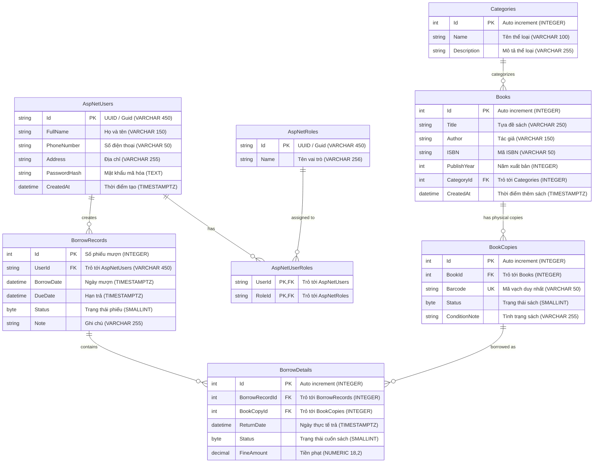

# 📖 BẢNG TÓM TẮT THIẾT KẾ CƠ SỞ DỮ LIỆU (DATABASE SPECIFICATION)

Tài liệu đặc tả toàn bộ cấu trúc Cơ sở Dữ liệu của hệ thống **Quản lý Thư viện (LightBrary)**, bao gồm mục đích của từng bảng, chi tiết các thuộc tính (đã đồng bộ với C# Entity Framework Core và PostgreSQL), sơ đồ ERD chi tiết, các chỉ mục (indexes) và ràng buộc toàn vẹn.

---

## 🗺️ Sơ Đồ Quan Hệ Tổng Thể (ERD)



---

## I. Phân Hệ Quản Trị Tài Khoản & Phân Quyền

Phân hệ này quản lý thông tin tài khoản người dùng (độc giả, thủ thư, admin) và quyền hạn trong hệ thống, tương thích với cấu trúc của ASP.NET Core Identity nhưng được triển khai độc lập (Custom POCO Entity) giúp nhóm phát triển tự chủ quản lý xác thực JWT và bảo mật mật khẩu.

### 1. Bảng `AspNetUsers` (Người dùng)
* **Mục đích:** Lưu trữ thông tin tài khoản đăng nhập của toàn bộ thành viên trong hệ thống (Độc giả, Nhân viên thủ thư, Quản trị viên).
* **Danh sách thuộc tính:**

| Tên thuộc tính | Kiểu C# | Kiểu PostgreSQL | Ràng buộc | Ý nghĩa / Mục đích |
| :--- | :--- | :--- | :--- | :--- |
| `Id` | `string` | `VARCHAR(450)` | **PK**, Not Null | Định danh duy nhất của người dùng (sinh bằng UUID/Guid). |
| `FullName` | `string` | `VARCHAR(150)` | Not Null | Họ và tên đầy đủ của người dùng. |
| `PhoneNumber` | `string?`| `VARCHAR(50)` | Nullable | Số điện thoại liên hệ để nhắc nhở trả sách. |
| `Address` | `string?`| `VARCHAR(255)` | Nullable | Địa chỉ cư trú của độc giả. |
| `PasswordHash` | `string?`| `TEXT` | Nullable | Mật khẩu đã được mã hóa an toàn (băm bằng PBKDF2/BCrypt/Argon2). |
| `CreatedAt` | `DateTime` | `TIMESTAMPTZ` | Default = UTC Now | Thời điểm tạo tài khoản. |

* **Liên kết với các bảng khác:**
  - **1 - N với `AspNetUserRoles`:** Một người dùng có thể có nhiều vai trò (Role).
  - **1 - N với `BorrowRecords`:** Một độc giả có thể có nhiều phiếu mượn sách trong suốt thời gian hoạt động.

---

### 2. Bảng `AspNetRoles` (Vai trò)
* **Mục đích:** Định nghĩa các nhóm quyền hạn trong hệ thống (ví dụ: `Admin`, `Librarian`, `Member`).
* **Danh sách thuộc tính:**

| Tên thuộc tính | Kiểu C# | Kiểu PostgreSQL | Ràng buộc | Ý nghĩa / Mục đích |
| :--- | :--- | :--- | :--- | :--- |
| `Id` | `string` | `VARCHAR(450)` | **PK**, Not Null | Định danh duy nhất của vai trò (UUID/Guid). |
| `Name` | `string?`| `VARCHAR(256)` | Nullable | Tên vai trò hiển thị (Admin, Librarian, Member...). |

* **Liên kết với các bảng khác:**
  - **1 - N với `AspNetUserRoles`:** Một vai trò có thể được gán cho nhiều người dùng.

---

### 3. Bảng `AspNetUserRoles` (Gán vai trò cho người dùng)
* **Mục đích:** Bảng trung gian giải quyết mối quan hệ **N - N (Nhiều - Nhiều)** giữa người dùng (`AspNetUsers`) và vai trò (`AspNetRoles`).
* **Danh sách thuộc tính:**

| Tên thuộc tính | Kiểu C# | Kiểu PostgreSQL | Ràng buộc | Ý nghĩa / Mục đích |
| :--- | :--- | :--- | :--- | :--- |
| `UserId` | `string` | `VARCHAR(450)` | **PK, FK**, Not Null | Khóa ngoại trỏ đến `AspNetUsers(Id)`. |
| `RoleId` | `string` | `VARCHAR(450)` | **PK, FK**, Not Null | Khóa ngoại trỏ đến `AspNetRoles(Id)`. |

* **Liên kết & Ràng buộc toàn vẹn:**
  - Cặp `(UserId, RoleId)` tạo thành **Khóa chính phức hợp (Composite Primary Key)**.
  - **Cascade Delete:** Khi xóa một người dùng hoặc một vai trò, bản ghi phân quyền tương ứng sẽ tự động bị xóa theo.

---

## II. Phân Hệ Quản Trị Danh Mục & Sách

Phân hệ quản lý thông tin về các thể loại sách, thông tin đầu sách lý thuyết và các bản sao vật lý cụ thể nằm trên từng kệ sách.

### 4. Bảng `Categories` (Thể loại sách)
* **Mục đích:** Phân loại sách theo từng lĩnh vực (Khoa học, Văn học, Công nghệ thông tin, Lịch sử...) giúp độc giả dễ tìm kiếm.
* **Danh sách thuộc tính:**

| Tên thuộc tính | Kiểu C# | Kiểu PostgreSQL | Ràng buộc | Ý nghĩa / Mục đích |
| :--- | :--- | :--- | :--- | :--- |
| `Id` | `int` | `INTEGER` | **PK**, Auto Increment | Mã định danh duy nhất của thể loại (tự tăng). |
| `Name` | `string` | `VARCHAR(100)` | Not Null | Tên thể loại sách. |
| `Description` | `string?`| `VARCHAR(255)` | Nullable | Mô tả chi tiết về thể loại. |

* **Liên kết với các bảng khác:**
  - **1 - N với `Books`:** Một thể loại có thể chứa nhiều đầu sách. Khi xóa một thể loại có chứa sách, hệ thống áp dụng `Restrict` (chặn không cho xóa để tránh mất dữ liệu sách).

---

### 5. Bảng `Books` (Đầu sách / Tác phẩm)
* **Mục đích:** Lưu trữ thông tin danh mục về **đầu sách** (thông tin chung về tác phẩm như tiêu đề, tác giả, năm xuất bản). Lưu ý: Đây là khái niệm đầu sách, không đại diện cho từng cuốn sách vật lý trên kệ.
* **Danh sách thuộc tính:**

| Tên thuộc tính | Kiểu C# | Kiểu PostgreSQL | Ràng buộc | Ý nghĩa / Mục đích |
| :--- | :--- | :--- | :--- | :--- |
| `Id` | `int` | `INTEGER` | **PK**, Auto Increment | Mã định danh duy nhất của đầu sách. |
| `Title` | `string` | `VARCHAR(250)` | Not Null | Tựa đề cuốn sách. |
| `Author` | `string` | `VARCHAR(150)` | Not Null | Tên tác giả hoặc nhóm tác giả. |
| `ISBN` | `string?`| `VARCHAR(50)` | Nullable | Mã số tiêu chuẩn quốc tế cho sách (ISBN). |
| `PublishYear` | `int?` | `INTEGER` | Nullable | Năm xuất bản sách. |
| `CategoryId` | `int` | `INTEGER` | **FK**, Not Null | Khóa ngoại trỏ đến `Categories(Id)`. |
| `CreatedAt` | `DateTime` | `TIMESTAMPTZ` | Default = UTC Now | Ngày đầu sách được nhập vào hệ thống. |

* **Liên kết với các bảng khác:**
  - **N - 1 với `Categories`:** Mỗi đầu sách bắt buộc phải thuộc về một thể loại (`OnDelete(DeleteBehavior.Restrict)`).
  - **1 - N với `BookCopies`:** Một đầu sách có thể có nhiều bản sao vật lý thực tế trên kệ (ví dụ: Thư viện mua 5 cuốn "Clean Architecture" thì có 1 đầu sách và 5 bản sao).

---

### 6. Bảng `BookCopies` (Bản sao sách vật lý trên kệ)
* **Mục đích:** Đại diện cho từng cuốn sách thực tế cầm trên tay nằm ở từng kệ trong thư viện. Mỗi bản sao được dán một mã vạch (Barcode) riêng biệt để thủ thư quét mã khi cho mượn.
* **Danh sách thuộc tính:**

| Tên thuộc tính | Kiểu C# | Kiểu PostgreSQL | Ràng buộc | Ý nghĩa / Mục đích |
| :--- | :--- | :--- | :--- | :--- |
| `Id` | `int` | `INTEGER` | **PK**, Auto Increment | Mã định danh bản sao sách. |
| `BookId` | `int` | `INTEGER` | **FK**, Not Null | Khóa ngoại trỏ đến đầu sách tương ứng `Books(Id)`. |
| `Barcode` | `string` | `VARCHAR(50)` | Not Null, **Unique Index** | Mã vạch dán trên gáy sách (duy nhất trên toàn hệ thống). |
| `Status` | `BookCopyStatus` | `SMALLINT` | Default = 0 (`Available`) | Trạng thái vật lý của cuốn sách: `Available` (Có sẵn), `Borrowed` (Đang được mượn), `Lost` (Mất/Hỏng). |
| `ConditionNote` | `string?`| `VARCHAR(255)` | Nullable | Ghi chú tình trạng sách (ví dụ: "Mới 100%", "Rách bìa trang cuối"...). |

* **Liên kết với các bảng khác:**
  - **N - 1 với `Books`:** Mỗi bản sao phải thuộc về một đầu sách. Nếu xóa đầu sách, toàn bộ bản sao của nó sẽ bị xóa theo (`Cascade Delete`).
  - **1 - N với `BorrowDetails`:** Một cuốn sách vật lý có thể nằm trong nhiều lượt mượn khác nhau theo lịch sử thời gian.

---

## III. Phân Hệ Nghiệp Vụ Mượn - Trả Sách

Phân hệ cốt lõi phục vụ quy trình độc giả mượn sách, hẹn ngày trả, theo dõi hạn trả và tính phí phạt trễ hạn hoặc làm mất sách.

### 7. Bảng `BorrowRecords` (Phiếu mượn sách)
* **Mục đích:** Đại diện cho một lần độc giả đến thư viện mượn sách (gồm ngày mượn, hạn trả và người mượn). Một phiếu mượn có thể mượn nhiều cuốn sách cùng lúc.
* **Danh sách thuộc tính:**

| Tên thuộc tính | Kiểu C# | Kiểu PostgreSQL | Ràng buộc | Ý nghĩa / Mục đích |
| :--- | :--- | :--- | :--- | :--- |
| `Id` | `int` | `INTEGER` | **PK**, Auto Increment | Số phiếu mượn (Mã định danh phiếu mượn). |
| `UserId` | `string` | `VARCHAR(450)` | **FK**, Not Null | Khóa ngoại trỏ tới `AspNetUsers(Id)` (Ai là người mượn). |
| `BorrowDate` | `DateTime` | `TIMESTAMPTZ` | Default = UTC Now | Ngày và giờ lập phiếu mượn sách. |
| `DueDate` | `DateTime` | `TIMESTAMPTZ` | Not Null | Ngày hẹn trả sách tối đa (quá ngày này sẽ bị tính trễ hạn). |
| `Status` | `BorrowRecordStatus` | `SMALLINT` | Default = 0 (`Borrowing`) | Trạng thái tổng quát của phiếu: `Borrowing` (Đang mượn), `Returned` (Đã trả hết), `Overdue` (Quá hạn). |
| `Note` | `string?`| `VARCHAR(255)` | Nullable | Ghi chú thêm của thủ thư khi lập phiếu. |

* **Liên kết với các bảng khác:**
  - **N - 1 với `AspNetUsers`:** Thuộc về một độc giả cụ thể (`OnDelete(DeleteBehavior.Restrict)` để bảo toàn lịch sử mượn).
  - **1 - N với `BorrowDetails`:** Một phiếu mượn chứa một hoặc nhiều dòng chi tiết các cuốn sách được mượn. Khi xóa phiếu mượn, toàn bộ chi tiết đi kèm sẽ tự xóa (`Cascade Delete`).

---

### 8. Bảng `BorrowDetails` (Chi tiết các cuốn sách trong phiếu mượn)
* **Mục đích:** Ghi nhận cụ thể từng cuốn sách vật lý (`BookCopies`) được mang đi trong phiếu mượn, theo dõi ngày thực tế mang trả của từng cuốn và số tiền phạt riêng cho từng cuốn (nếu trả muộn hoặc làm hỏng/mất).
* **Danh sách thuộc tính:**

| Tên thuộc tính | Kiểu C# | Kiểu PostgreSQL | Ràng buộc | Ý nghĩa / Mục đích |
| :--- | :--- | :--- | :--- | :--- |
| `Id` | `int` | `INTEGER` | **PK**, Auto Increment | Mã định danh của dòng chi tiết mượn. |
| `BorrowRecordId` | `int` | `INTEGER` | **FK**, Not Null | Khóa ngoại trỏ đến `BorrowRecords(Id)`. |
| `BookCopyId` | `int` | `INTEGER` | **FK**, Not Null | Khóa ngoại trỏ đích danh tới cuốn sách vật lý `BookCopies(Id)`. |
| `ReturnDate` | `DateTime?`| `TIMESTAMPTZ` | Nullable | Ngày thực tế người mượn mang cuốn sách này tới trả (null nghĩa là chưa trả). |
| `Status` | `BorrowDetailStatus` | `SMALLINT` | Default = 0 (`Borrowing`) | Trạng thái riêng của cuốn này: `Borrowing` (Đang mượn), `Returned` (Đã trả xong), `Lost` (Báo làm mất). |
| `FineAmount` | `decimal` | `NUMERIC(18,2)` | Default = 0 | Số tiền phạt phát sinh cho cuốn này (phạt quá hạn theo ngày hoặc phí đền bù sách mất). |

* **Liên kết với các bảng khác:**
  - **N - 1 với `BorrowRecords`:** Thuộc về một phiếu mượn nhất định (`OnDelete(DeleteBehavior.Cascade)`).
  - **N - 1 với `BookCopies`:** Chỉ đích danh cuốn sách vật lý có mã vạch nào được mượn (`OnDelete(DeleteBehavior.Restrict)`).

---

## IV. Bảng Danh Mục Trạng Thái (Enums)

Hệ thống sử dụng các kiểu liệt kê Enum C# chuẩn hóa (lưu dưới dạng số nguyên `SMALLINT` trong database để tối ưu hóa hiệu năng và dung lượng lưu trữ):

### 1. `BookCopyStatus` (Trạng thái sách vật lý)
- `0 - Available`: Sách đang nằm trên kệ, sẵn sàng cho mượn.
- `1 - Borrowed`: Sách đã được độc giả mượn mang về.
- `2 - Lost`: Sách bị thất lạc, rách nát hoặc làm mất, không thể cho mượn.

### 2. `BorrowRecordStatus` (Trạng thái phiếu mượn)
- `0 - Borrowing`: Phiếu mượn đang có hiệu lực (độc giả vẫn đang giữ sách).
- `1 - Returned`: Độc giả đã hoàn trả đầy đủ tất cả các cuốn sách trong phiếu.
- `2 - Overdue`: Đã vượt quá hạn trả (`DueDate`) nhưng độc giả chưa hoàn tất trả sách.

### 3. `BorrowDetailStatus` (Trạng thái chi tiết từng cuốn mượn)
- `0 - Borrowing`: Cuốn sách này chưa được trả.
- `1 - Returned`: Đã nhận lại cuốn sách này và kiểm tra nguyên vẹn.
- `2 - Lost`: Độc giả báo làm mất cuốn này (sẽ tính tiền đền bù vào `FineAmount`).

---

## V. Bảng Tổng Hợp Quan Hệ Giữa Các Bảng (Relationship Matrix)

| Bảng nguồn | Bảng đích | Loại quan hệ | Ý nghĩa nghiệp vụ | Hành vi khi xóa (On Delete) |
| :--- | :--- | :---: | :--- | :--- |
| `AspNetUsers` | `AspNetUserRoles` | 1 - N | Một người dùng có nhiều vai trò | `Cascade Delete` |
| `AspNetRoles` | `AspNetUserRoles` | 1 - N | Một vai trò được gán cho nhiều người | `Cascade Delete` |
| `Categories` | `Books` | 1 - N | Một thể loại chứa nhiều đầu sách | `Restrict` (Chặn xóa nếu còn sách) |
| `Books` | `BookCopies` | 1 - N | Một đầu sách có nhiều bản sao vật lý trên kệ | `Cascade Delete` |
| `AspNetUsers` | `BorrowRecords` | 1 - N | Một người dùng tạo nhiều phiếu mượn | `Restrict` (Bảo toàn lịch sử mượn) |
| `BorrowRecords` | `BorrowDetails` | 1 - N | Một phiếu mượn chứa nhiều cuốn sách | `Cascade Delete` |
| `BookCopies` | `BorrowDetails` | 1 - N | Một bản sao sách xuất hiện trong nhiều lượt mượn | `Restrict` (Bảo toàn lịch sử) |

---

## VI. Danh Sách Chỉ Mục Tối Ưu Truy Vấn (Indexes)

Các chỉ mục này đã được định nghĩa trong `LibraryDbContext.cs` và cấu hình trong file Migration để tối ưu hiệu năng truy vấn:

| Tên Chỉ Mục (Index) | Bảng áp dụng | Cột đánh chỉ mục | Loại Index | Mục đích tối ưu |
| :--- | :--- | :--- | :--- | :--- |
| `IX_BookCopies_Barcode` | `BookCopies` | `Barcode` | **UNIQUE** | Đảm bảo mã vạch không trùng lặp; tăng tốc tra cứu khi thủ thư quét mã vạch. |
| `IX_BookCopies_BookId` | `BookCopies` | `BookId` | Non-Unique | Tối ưu truy vấn tìm tất cả các bản sao vật lý của một đầu sách. |
| `IX_Books_CategoryId` | `Books` | `CategoryId` | Non-Unique | Tối ưu tìm kiếm và lọc danh sách sách theo thể loại. |
| `IX_BorrowRecords_UserId` | `BorrowRecords` | `UserId` | Non-Unique | Tối ưu truy vấn lịch sử mượn trả của một độc giả. |
| `IX_BorrowDetails_BorrowRecordId` | `BorrowDetails` | `BorrowRecordId` | Non-Unique | Tối ưu lấy toàn bộ danh sách các cuốn sách nằm trong một phiếu mượn. |
| `IX_BorrowDetails_BookCopyId` | `BorrowDetails` | `BookCopyId` | Non-Unique | Tối ưu tra cứu lịch sử mượn của một cuốn sách vật lý cụ thể. |
| `IX_AspNetUserRoles_RoleId` | `AspNetUserRoles` | `RoleId` | Non-Unique | Tối ưu tìm kiếm danh sách người dùng thuộc một vai trò nhất định. |

---

## VII. Lệnh Đồng Bộ Database (Migration Commands)

```bash
# 1. Tạo migration mới khi có thay đổi Entity:
dotnet ef migrations add <TenMigration> \
  --project src/Library.Infrastructure/ \
  --startup-project src/Library.Api/ \
  --output-dir Persistence/Migrations

# 2. Cập nhật các thay đổi vào cơ sở dữ liệu PostgreSQL:
dotnet ef database update \
  --project src/Library.Infrastructure/ \
  --startup-project src/Library.Api/
```