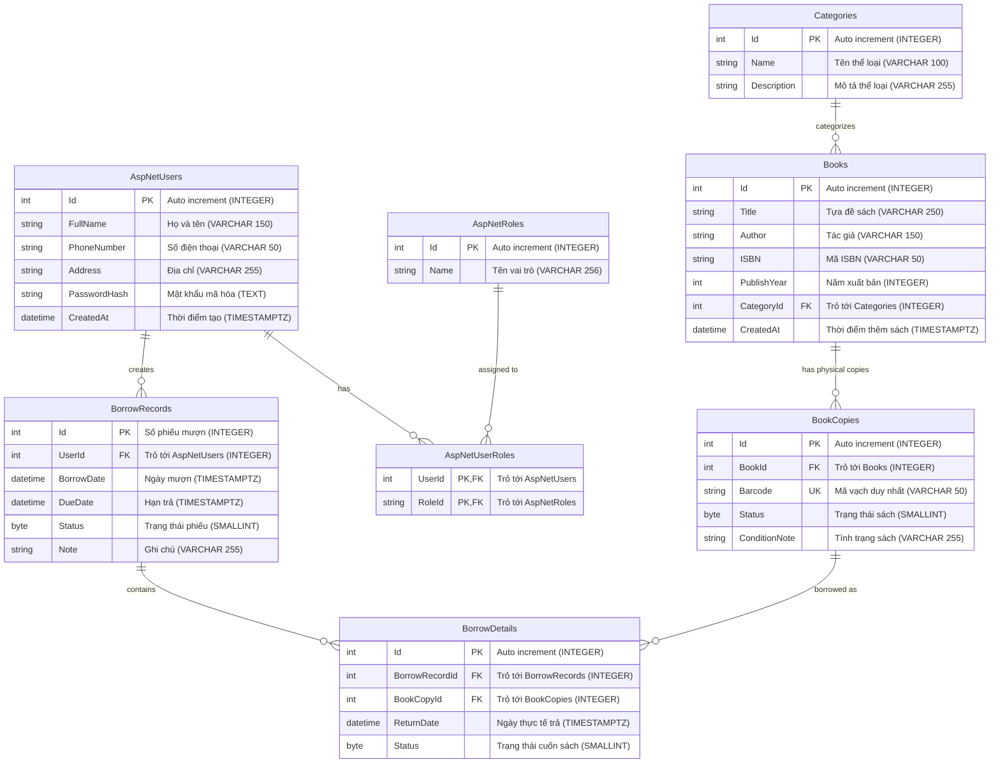

# 📖 BẢNG TÓM TẮT THIẾT KẾ CƠ SỞ DỮ LIỆU (DATABASE SPECIFICATION)

Tài liệu đặc tả toàn bộ cấu trúc Cơ sở Dữ liệu của hệ thống **Quản lý Thư viện (LightBrary)**, bao gồm mục đích của từng bảng


## 🗺️ Sơ Đồ Quan Hệ Tổng Thể (ERD)



---

## I. Phân Hệ Quản Trị Tài Khoản & Phân Quyền

### 1. Bảng `AspNetUsers` (Người dùng)

| Tên thuộc tính | Kiểu C# | Kiểu PostgreSQL | Ràng buộc | Ý nghĩa / Mục đích |
| :--- | :--- | :--- | :--- | :--- |
| `Id` | `int` | `INTEGER` | **PK**, Not Null | Định danh duy nhất của người dùng). |
| `FullName` | `string` | `VARCHAR(150)` | Not Null | Họ và tên đầy đủ của người dùng. |
| `PhoneNumber` | `string`| `VARCHAR(50)` | Not Null, Unique | Số điện thoại liên hệ để nhắc nhở trả sách. |
| `Address` | `string?`| `VARCHAR(255)` | Nullable | Địa chỉ cư trú của độc giả. |
| `PasswordHash` | `string`| `TEXT` | Not null | Mật khẩu đã được mã hóa an toàn (băm bằng PBKDF2/BCrypt/Argon2). |
| `CreatedAt` | `DateTime` | `TIMESTAMPTZ` | Default = UTC Now | Thời điểm tạo tài khoản. |


---

### 2. Bảng `AspNetRoles` (Vai trò)
* **Mục đích:** Định nghĩa các nhóm quyền hạn trong hệ thống (`ADMIN`, `LIBRARIAN`, `USER`).

| Tên thuộc tính | Kiểu C# | Kiểu PostgreSQL | Ràng buộc | Ý nghĩa / Mục đích |
| :--- | :--- | :--- | :--- | :--- |
| `Id` | `int` | `INTEGER` | **PK**, Not Null | Định danh duy nhất của vai trò. |
| `Name` | `string`| `VARCHAR(256)` | NOT NULL, Unique | Tên vai trò hiển thị (Admin, Librarian, Member...). |


---

### 3. Bảng `AspNetUserRoles` (Gán vai trò cho người dùng)


| Tên thuộc tính | Kiểu C# | Kiểu PostgreSQL | Ràng buộc | Ý nghĩa / Mục đích |
| :--- | :--- | :--- | :--- | :--- |
| `UserId` | `int` | `INTEGER` | **PK, FK**, Not Null | Khóa ngoại trỏ đến `AspNetUsers(Id)`. |
| `RoleId` | `int` | `INTEGER` | **PK, FK**, Not Null | Khóa ngoại trỏ đến `AspNetRoles(Id)`. |

* **Liên kết & Ràng buộc toàn vẹn:**
  - Cặp `(UserId, RoleId)` tạo thành **Khóa chính phức hợp (Composite Primary Key)**.

---

## II. Phân Hệ Quản Trị Danh Mục & Sách

Phân hệ quản lý thông tin về các thể loại sách, thông tin đầu sách lý thuyết và các bản sao vật lý cụ thể nằm trên từng kệ sách.

### 4. Bảng `Categories` (Thể loại sách)
* **Mục đích:** Phân loại sách theo từng lĩnh vực (Khoa học, Văn học, Công nghệ thông tin, Lịch sử...) giúp độc giả dễ tìm kiếm.

| Tên thuộc tính | Kiểu C# | Kiểu PostgreSQL | Ràng buộc | Ý nghĩa / Mục đích |
| :--- | :--- | :--- | :--- | :--- |
| `Id` | `int` | `INTEGER` | **PK**, Auto Increment | Mã định danh duy nhất của thể loại (tự tăng). |
| `Name` | `string` | `VARCHAR(100)` | Not Null, Unique | Tên thể loại sách. |
| `Description` | `string?`| `VARCHAR(255)` | Nullable | Mô tả chi tiết về thể loại. |

---

### 5. Bảng `Books` (Đầu sách / Tác phẩm)
* **Mục đích:** Lưu trữ thông tin danh mục về **đầu sách** (thông tin chung về tác phẩm như tiêu đề, tác giả, năm xuất bản). Lưu ý: Đây là khái niệm đầu sách, không đại diện cho từng cuốn sách vật lý trên kệ.

| Tên thuộc tính | Kiểu C# | Kiểu PostgreSQL | Ràng buộc | Ý nghĩa / Mục đích |
| :--- | :--- | :--- | :--- | :--- |
| `Id` | `int` | `INTEGER` | **PK**, Auto Increment | Mã định danh duy nhất của đầu sách. |
| `Title` | `string` | `VARCHAR(250)` | Not Null | Tựa đề cuốn sách. |
| `Author` | `string` | `VARCHAR(150)` | Not Null | Tên tác giả hoặc nhóm tác giả. |
| `ISBN` | `string`| `VARCHAR(50)` | Not Null, Unique | Mã số tiêu chuẩn quốc tế cho sách (ISBN). |
| `PublishYear` | `int?` | `INTEGER` | Nullable | Năm xuất bản sách. |
| `CategoryId` | `int` | `INTEGER` | **FK**, Not Null | Khóa ngoại trỏ đến `Categories(Id)`. |
| `CreatedAt` | `DateTime` | `TIMESTAMPTZ` | Default = UTC Now | Ngày đầu sách được nhập vào hệ thống. |


---

### 6. Bảng `BookCopies` (Bản sao sách vật lý trên kệ)
* **Mục đích:** Đại diện cho từng cuốn sách thực tế cầm trên tay nằm ở từng kệ trong thư viện. Mỗi bản sao được dán một mã vạch (Barcode) riêng biệt để thủ thư quét mã khi cho mượn.

| Tên thuộc tính | Kiểu C# | Kiểu PostgreSQL | Ràng buộc | Ý nghĩa / Mục đích |
| :--- | :--- | :--- | :--- | :--- |
| `Id` | `int` | `INTEGER` | **PK**, Auto Increment | Mã định danh bản sao sách. |
| `BookId` | `int` | `INTEGER` | **FK**, Not Null | Khóa ngoại trỏ đến đầu sách tương ứng `Books(Id)`. |
| `Barcode` | `string` | `VARCHAR(50)` | Not Null, Unique | Mã vạch dán trên gáy sách (duy nhất trên toàn hệ thống). |
| `Status` | `BookCopyStatus` | `SMALLINT` | Default = 0 (`Available`) | Trạng thái vật lý của cuốn sách: `Available` (Có sẵn), `Borrowed` (Đang được mượn), `Lost` (Mất/Hỏng). |
| `ConditionNote` | `string?`| `VARCHAR(255)` | Nullable | Ghi chú tình trạng sách (ví dụ: "Mới 100%", "Rách bìa trang cuối"...). |


---

## III. Phân Hệ Nghiệp Vụ Mượn - Trả Sách

Phân hệ cốt lõi phục vụ quy trình độc giả mượn sách, hẹn ngày trả, theo dõi hạn trả
### 7. Bảng `BorrowRecords` (Phiếu mượn sách)
* **Mục đích:** Đại diện cho một lần độc giả đến thư viện mượn sách (gồm ngày mượn, hạn trả và người mượn). Một phiếu mượn có thể mượn nhiều cuốn sách cùng lúc.
* **Danh sách thuộc tính:**

| Tên thuộc tính | Kiểu C# | Kiểu PostgreSQL | Ràng buộc | Ý nghĩa / Mục đích |
| :--- | :--- | :--- | :--- | :--- |
| `Id` | `int` | `INTEGER` | **PK**, Auto Increment | Số phiếu mượn (Mã định danh phiếu mượn). |
| `UserId` | `int` | `INTEGER` | **FK**, Not Null | Khóa ngoại trỏ tới `AspNetUsers(Id)` (Ai là người mượn). |
| `BorrowDate` | `DateTime` | `TIMESTAMPTZ` | Default = UTC Now | Ngày và giờ lập phiếu mượn sách. |
| `DueDate` | `DateTime` | `TIMESTAMPTZ` | Not Null | Ngày hẹn trả sách tối đa (quá ngày này sẽ bị tính trễ hạn). |
| `Status` | `BorrowRecordStatus` | `SMALLINT` | Default = 0 (`Borrowing`) | Trạng thái tổng quát của phiếu: `Borrowing` (Đang mượn), `Returned` (Đã trả hết). `Lost` |
| `Note` | `string?`| `VARCHAR(255)` | Nullable | Ghi chú thêm của thủ thư khi lập phiếu. |

---

### 8. Bảng `BorrowDetails` (Chi tiết các cuốn sách trong phiếu mượn)
* **Mục đích:** Ghi nhận cụ thể từng cuốn sách vật lý (`BookCopies`) được mang đi trong phiếu mượn, theo dõi ngày thực tế mang trả của từng cuốn.

| Tên thuộc tính | Kiểu C# | Kiểu PostgreSQL | Ràng buộc | Ý nghĩa / Mục đích |
| :--- | :--- | :--- | :--- | :--- |
| `Id` | `int` | `INTEGER` | **PK**, Auto Increment | Mã định danh của dòng chi tiết mượn. |
| `BorrowRecordId` | `int` | `INTEGER` | **FK**, Not Null | Khóa ngoại trỏ đến `BorrowRecords(Id)`. |
| `BookCopyId` | `int` | `INTEGER` | **FK**, Not Null | Khóa ngoại trỏ đích danh tới cuốn sách vật lý `BookCopies(Id)`. |
| `ReturnDate` | `DateTime?`| `TIMESTAMPTZ` | Nullable | Ngày thực tế người mượn mang cuốn sách này tới trả (null nghĩa là chưa trả). |
| `Status` | `BorrowDetailStatus` | `SMALLINT` | Default = 0 (`Borrowing`) | Trạng thái riêng của cuốn này: `Borrowing` (Đang mượn), `Returned` (Đã trả xong), `Lost` (Báo làm mất). |

(`BorrowRecordId`, `BookCopyId`) unique

---

## VII. Lệnh Đồng Bộ Database (Migration Commands)

```bash
# 1. Tạo migration mới khi có thay đổi Entity:
dotnet ef migrations add <TenMigration> \
  --project back_end/light_brary/ \
  --startup-project back_end/light_brary/ \
  --output-dir code/Data/Migrations \
  --namespace light_brary.Data.Migrations

# 2. Cập nhật các thay đổi vào cơ sở dữ liệu PostgreSQL:
dotnet ef database update \
  --project back_end/light_brary/ \
  --startup-project back_end/light_brary/
```


